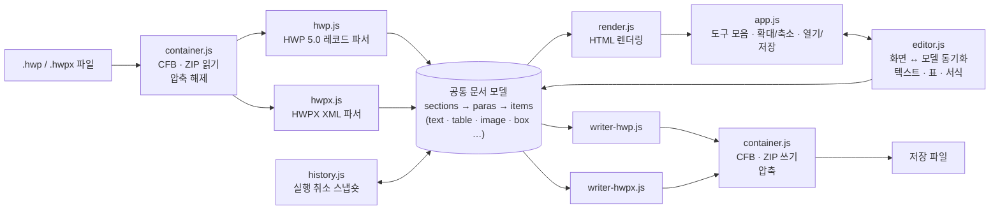

# HWP 뷰어

브라우저에서 한글 문서(`.hwp`, `.hwpx`)를 열고, 편집하고, 같은 형식으로 저장하는 웹 도구입니다.
설치나 서버가 필요 없고, 문서는 브라우저 안에서만 처리되며 어디에도 업로드되지 않습니다.

## 주소

| 구분 | 주소 |
|---|---|
| 서비스 (GitHub Pages) | https://mechenginee.github.io/HwpViewer/ |
| 소스 저장소 | https://github.com/MechEnginee/HwpViewer |

- 로컬에서 쓰려면 `index.html` 을 Chrome 또는 Edge 로 열면 됩니다 (빌드 과정 없음).
- 권장 브라우저: Chrome, Edge (PC/모바일), Safari (iOS 16.4 이상). 저장 위치 선택 창은 Chrome/Edge(PC)에서만
  뜨고, 그 밖의 브라우저에서는 다운로드로 저장됩니다.

## 기능

### 보기
- 글자 모양(글꼴·크기·굵게·기울임·밑줄·취소선·색·위/아래 첨자), 문단 모양(정렬·여백·들여쓰기·줄 간격·배경)
- 표(셀 병합·테두리·배경), 그림, 글상자, 수식(스크립트 표시), 각주/미주
- 확대/축소: `−`/`+`/`100%`/`폭 맞춤`, `Ctrl` + 휠, 모바일 두 손가락 확대 (손가락 사이 지점 기준)
  - 문서는 항상 원본(100%) 크기로 배치한 뒤 통째로 확대/축소하므로 배율과 상관없이 줄바꿈과 모양이 원본과 같습니다.
  - 휴대폰에서는 파일을 열면 화면 폭에 맞춰 보이고, 화면을 돌리면 다시 맞춥니다.
- 인쇄 / PDF 저장 (`Ctrl+P`)

### 편집 (`Ctrl+E`)
| 분류 | 기능 |
|---|---|
| 텍스트 | 입력·삭제, 문단 나누기(`Enter`)/합치기, 줄 바꿈(`Shift+Enter`), 붙여넣기(일반 텍스트) |
| 글자 | 크기(pt), 굵게(`Ctrl+B`), 글자 서식 복사 🖌 |
| 문단 | 왼쪽 / 가운데 / 오른쪽 / 양쪽 정렬 (여러 문단을 선택해 한꺼번에 적용) |
| 표 만들기 | `표 ▾` 격자에서 크기를 골라 삽입 (줄·칸 수 직접 입력도 가능), 표 안에 표 넣기 |
| 표 편집 | 행·열 추가/삭제, 표 삭제, 표 선을 끌어 열 폭·행 높이 조절, 셀 서식 복사, `Tab` 으로 셀 이동 |
| 표 테두리 | 범위(표 전체 / 바깥쪽 / 현재 셀)에 없음 / 실선(0.12mm) / 굵게(0.4mm) 적용 |
| 실행 취소 | 실행 취소(`Ctrl+Z`), 다시 실행(`Ctrl+Y`, `Ctrl+Shift+Z`), 초기화(파일을 처음 열었을 때 상태로) |

### 저장 (`Ctrl+S`, 다른 이름으로 `Ctrl+Shift+S`)
- 원래 형식(.hwp / .hwpx) 그대로 저장합니다.
- 편집한 문단·표만 다시 쓰고 나머지는 원본 데이터를 그대로 유지합니다.

### 지원하지 않는 것
- HWPML(XML), 한글 3.0 이하 구버전, 암호가 걸린 문서, 배포용 문서
- 머리말/꼬리말·필드·책갈피 등은 표시하지 않고 원본 그대로 보존만 합니다.

## 아키텍처

서버 없이 브라우저에서만 동작하는 정적 웹 앱입니다. 파일은 `File` API 로 읽어 메모리에서 처리합니다.

### 처리 흐름
1. **열기**: 파일 앞부분으로 형식을 판별합니다. `D0 CF` 이면 HWP(CFB/OLE 복합 문서), `PK` 이면 HWPX(ZIP)입니다.
   그다음 컨테이너를 풀고 각 파서가 **공통 문서 모델**로 변환합니다.
   - 모델의 각 문단·표·셀은 원본 레코드(HWP) 또는 XML 요소(HWPX)를 `raw` 로 함께 들고 있습니다.
2. **렌더링**: 모델을 쪽 단위 HTML로 그립니다. 편집 모드에서는 문단마다 `contenteditable` 영역이 됩니다.
3. **편집**: 화면에서 바뀐 내용을 모델에 반영하고, 바뀐 문단·표에 `dirty` 표시를 합니다.
   - 편집할 때마다 `history.js` 가 모델 스냅숏을 쌓습니다. 바뀌지 않은 부분은 이전 기록을 재사용합니다.
4. **저장**: `dirty` 인 문단·표만 레코드/XML을 다시 만듭니다.
   - 새 글자 모양·문단 모양·테두리는 DocInfo / `header.xml` 에 추가합니다.
   - 나머지 스트림과 ZIP 항목은 원본 바이트 그대로 다시 묶습니다.

### 파일 구성

| 파일 | 역할 |
|---|---|
| `index.html` | 화면 구조 (도구 모음, 편집 도구, 문서 영역) |
| `css/viewer.css` | 화면·인쇄 스타일, 다크 모드 |
| `js/container.js` | CFB(OLE 복합 문서) / ZIP 읽기·쓰기, deflate 압축·해제, CRC32 |
| `js/hwp.js` | HWP 5.0 파서 (DocInfo: 글꼴·글자/문단 모양·테두리, BodyText: 문단·표·그림·각주) |
| `js/hwpx.js` | HWPX 파서 (`content.hpf`, `header.xml`, `section*.xml`) |
| `js/render.js` | 문서 모델 → HTML 렌더러 |
| `js/editor.js` | 편집기 (화면↔모델 동기화, 문단 나누기/합치기, 표 편집·만들기, 테두리, 정렬, 서식 복사) |
| `js/history.js` | 실행 취소 / 다시 실행 / 초기화 (모델 스냅숏) |
| `js/writer-hwp.js` | HWP 저장 (문단·표 레코드 재작성, DocInfo 모양 추가, 새 표 레코드 생성) |
| `js/writer-hwpx.js` | HWPX 저장 (문단·표 XML 재작성, `header.xml` 모양 추가, 새 표 XML 생성) |
| `js/app.js` | 앱 진입점 (열기/저장, 도구 모음, 확대/축소·손가락 확대, 단축키) |
| `.github/workflows/pages.yml` | GitHub Pages 배포 |

## 사용한 기술 · 라이브러리

외부 JavaScript 라이브러리나 프레임워크, 빌드 도구는 쓰지 않습니다. 순수 JavaScript(ES2020)와 브라우저 기본 API만으로 만들었습니다.

| 용도 | 사용한 것 |
|---|---|
| 압축 해제 / 압축 (HWP 스트림, ZIP 항목) | `DecompressionStream` / `CompressionStream` (`deflate-raw`) |
| CFB(OLE)·ZIP 컨테이너, CRC32 | 직접 구현 (`js/container.js`) |
| HWPX XML 읽기 / 쓰기 | `DOMParser` / `XMLSerializer` |
| 바이너리 레코드 처리 | `ArrayBuffer`, `DataView`, `Uint8Array` |
| 편집 | `contenteditable`, Selection / Range API |
| 파일 열기 / 저장 | `File` API, 드래그 앤 드롭, File System Access API(`showSaveFilePicker`, 지원 브라우저만), `Blob` 다운로드 |
| 그림 표시 | `Blob` + `URL.createObjectURL` |
| 확대/축소 | CSS `transform: scale`, `ResizeObserver`, Touch 이벤트(두 손가락 확대) |
| 배포 | GitHub Actions (`actions/checkout@v4`, `actions/configure-pages@v5`, `actions/upload-pages-artifact@v3`, `actions/deploy-pages@v4`) |

## 배포

- `main` 브랜치에 push 하면 GitHub Actions(`.github/workflows/pages.yml`)가 GitHub Pages 로 배포합니다.
  - 배포 대상은 `index.html`, `css/`, `js/` 뿐입니다.
  - 배포 파일에 `.hwp`/`.hwpx` 문서가 섞이면 배포를 중단합니다.
- 처음 한 번은 저장소의 **Settings → Pages → Source** 를 **GitHub Actions** 로 지정해야 합니다.
- 개인 문서(`Source/`, `*.hwp`, `*.hwpx`)와 테스트 폴더(`_test/`)는 `.gitignore` 로 저장소에서 제외합니다.
